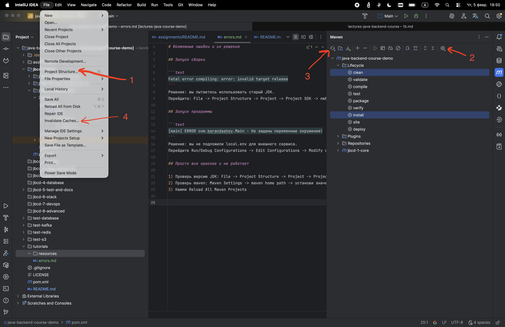

# Возможные ошибки и их решения

## Запуск сборки

```text
Fatal error compiling: error: invalid target release
```
Решение: вы пытаетесь использовать старый JDK.
Перейдите: File -> Project Structure -> Project -> SDK -> любой JDK 25

```text
Could not find a valid Docker environment. Please see logs and check configuration
```
Решение: вы не запустили docker. Запустите docker демон на компьютере (просто откройте docker desktop).

## Запуск программы

```text
application.properties not found
```
или
```text
В ресурсах не обнаружен application.properties файл с настройками
```
или
```text
В application.properties файле не задано значение для ключа
```

Проверьте наличие `application.properties` или `application.yml` внутри ресурсов запускаемого примера.
Если меняли настройки подключения в docker compose, то пропишите изменения.

## Просто все красное и не работает

1) Проверь версию JDK: File -> Project Structure -> Project -> SDK -> должен стоять любой JDK 25
2) Проверь maven: Maven Settings -> maven home path -> установи значение Bundled
3) Нажми Reload All Maven Projects
4) File -> invalidate caches -> выбрать все галочки -> invalidate and restart


