# Большой туториал по началу работы

## Установка необходимого ПО

В первую очередь тебе необходимы 2 вещи: docker и среда разработки. 

Установить докер можно [с этой страницы](https://docs.docker.com/get-started/get-docker/). Выбери свою операционную систему
и следуй инструкциям.

В качестве среды разработки можешь использовать:
* Intellij idea (достаточно бесплатной версии)
* OpenIde (это импортозамещенный форк Intellij idea)

При установке ide (или при первом запуске) она предложит тебе установить git (соглашайся) и JDK (выбирай любую 25).
Maven уже будет внутри, отдельной установки не требуется. 

Если вы не работали до этого с github/gitlab с вашего пк, то скорее всего не добавили ssh ключ. Как это сделать читай в 
[моем туториале](ssh.md) или в официальных доках:
* https://docs.gitlab.com/user/ssh/
* https://docs.github.com/en/authentication/connecting-to-github-with-ssh/generating-a-new-ssh-key-and-adding-it-to-the-ssh-agent

После успешной аутентификации можно будет легко клонировать на компьютер приватные git-репозитории. Проверьте это. 
Не забывайте, что проект и лабы должны быть в публичном доступе.

## Создание проекта

Нажми на кнопку создания проекта и выбери раздел простого java приложения. Нужно будет заполнить несколько важных полей.

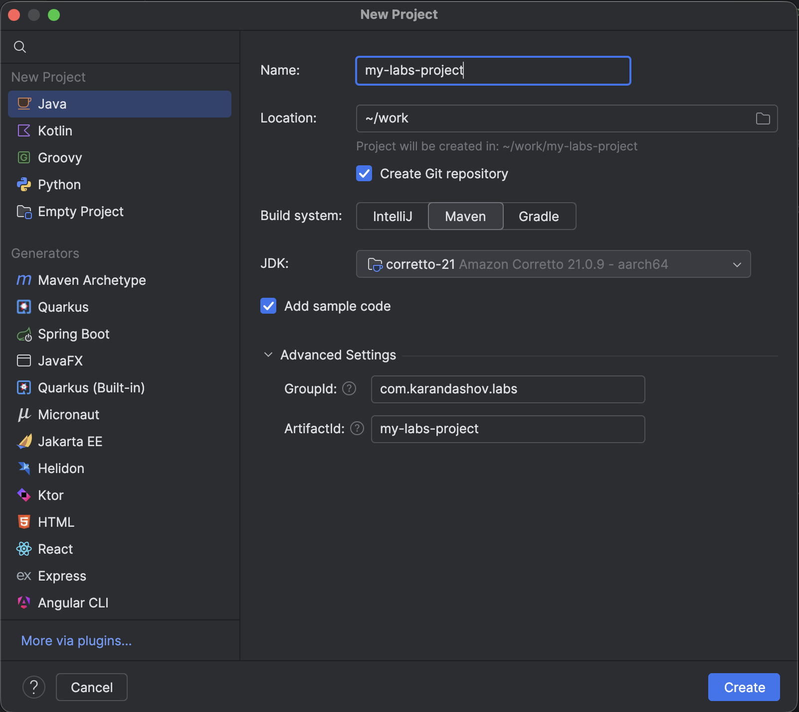

1) Name проекта/сервиса пишется через дефис маленькими буквами в kebab-case. В твоем случае это общее название будущего репозитория.
2) Location на твое усмотрение.
3) Обязательно поставь галочку Create git repository. Будет создан локальный репозиторий, который потом очень легко загрузить в gitlab/github.
4) Обязательно выбери систему сборки maven. В рамках курса мы используем именно его из-за простоты и жесткости. 
5) Выбери JDK, установленную на предыдущем шаге.
6) GroupId это уникальный идентификатор пространства имён проекта в Java-проектах. 
Обычно записывается в формате домена в обратном порядке, например `org.example` или `com.karandashov`.
Можно добавить дополнительные слова в качестве рездела. Например, для проекта лабораторок: `com.karandashov.labs`
7) artifact-id должно совпадать с Name.

## Очистка мусора

Вероятнее всего, в новосозданном проекте будет сгенерировано много мусора, от которого стоит сразу избавится.
Создай/открой файл .gitignore в корне проекта и допиши туда:
```gitignore
target/
.idea/
**/dependency-reduced-pom.xml
```
Нажми Ctrl+S (Cmd+S) для применения изменений. Таким образом мы избавились от всех будущих папок target с артефактами сборки и мусора ide.
Ты увидишь, как папка .ide стала рыжей — это нормально. Если что-то внутри не рыжее — удали папку .ide и перезапусти среду.

Удали папку `.mvn` - это maven wrapper, который не принято использовать в maven-проектах (в отличие от gradle, там это супер нужная штука).

Так как наш проект будет многомодульным — сгенерированная папка /src также не нужна. Удаляем.
В итоге останется только рыжая папка .ide, корневой pom.xml и .gitignore.

Приведи pom.xml в состояние по шаблону и нажми всплывшую справа кнопку maven (см картинку ниже).
```xml
<?xml version="1.0" encoding="UTF-8"?>
<project xmlns="http://maven.apache.org/POM/4.0.0"
         xmlns:xsi="http://www.w3.org/2001/XMLSchema-instance"
         xsi:schemaLocation="http://maven.apache.org/POM/4.0.0 http://maven.apache.org/xsd/maven-4.0.0.xsd">
    <modelVersion>4.0.0</modelVersion>

    <groupId>com.karandashov.labs</groupId>
    <artifactId>my-labs-project</artifactId>
    <version>1.0.0-SNAPSHOT</version>

    <!--  Это корневой pom, поэтому при сборке не нужно паковать jar - указываем "pom"  -->
    <packaging>pom</packaging>

    <properties>
        <maven.compiler.release>25</maven.compiler.release>
        <project.build.sourceEncoding>UTF-8</project.build.sourceEncoding>
        <maven-surefire-plugin.version>3.2.2</maven-surefire-plugin.version>
        <maven.shade.plugin.version>3.4.1</maven.shade.plugin.version>
        <junit.version>6.0.2</junit.version>
    </properties>

    <dependencyManagement>
        <dependencies>
            <!--  JUnit (Jupiter) для тестирования  -->
            <dependency>
                <groupId>org.junit.jupiter</groupId>
                <artifactId>junit-jupiter</artifactId>
                <version>${junit.version}</version>
                <scope>test</scope>
            </dependency>
        </dependencies>
    </dependencyManagement>

    <build>
        <pluginManagement>
            <plugins>
                <!-- Плагин для запуска тестов -->
                <plugin>
                    <groupId>org.apache.maven.plugins</groupId>
                    <artifactId>maven-surefire-plugin</artifactId>
                    <version>${maven-surefire-plugin.version}</version>
                </plugin>
            </plugins>
        </pluginManagement>
    </build>
</project>
```
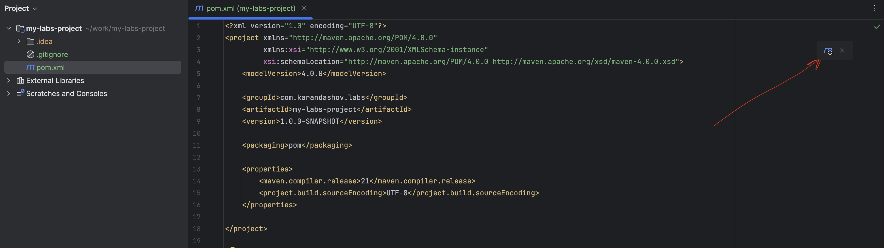

Таким образом получился сносный стартовый задел.

## Работа с git

Самое время начать работать с git, пока мы не сделали (и не потеряли) ничего важного. Надеюсь ты помнишь, что при создании 
проекта была поставлена галочка "Create git repository", а значит локальный репозиторий уже есть и можно выполнять разные git-операции
(кроме тех, что связаны с удаленным github/gitlab репозиторием). 

Закоммитим текущие изменения. Для этого откроем слева вкладку Commit и выберем все нужные файлы (у тебя их должно быть 2).

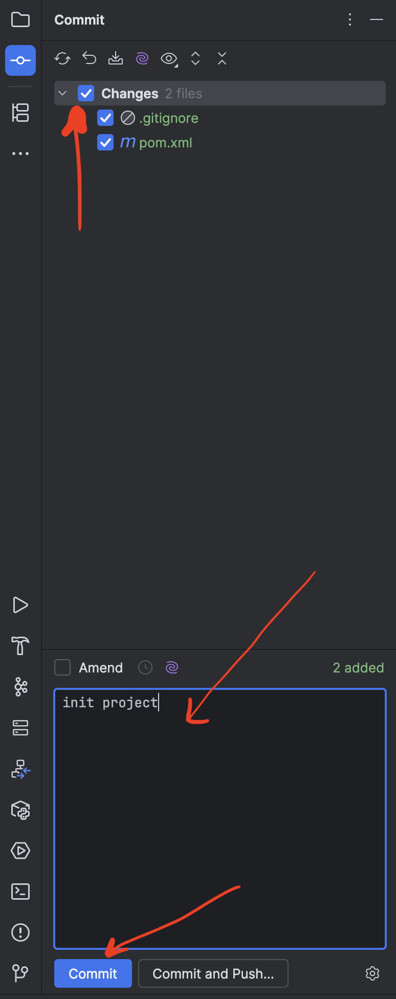

Отлично! Коммит в локальном репозитории состоялся. Теперь затащим это дело в удаленный репозиторий.

Зайдите в web-интерфейс вашего github/gitlab и создайте пустой репозиторий с тем же Name. Очень важно, чтобы он был ПОЛНОСТЬЮ пустым.
Никаких README, gitignore и прочего. 

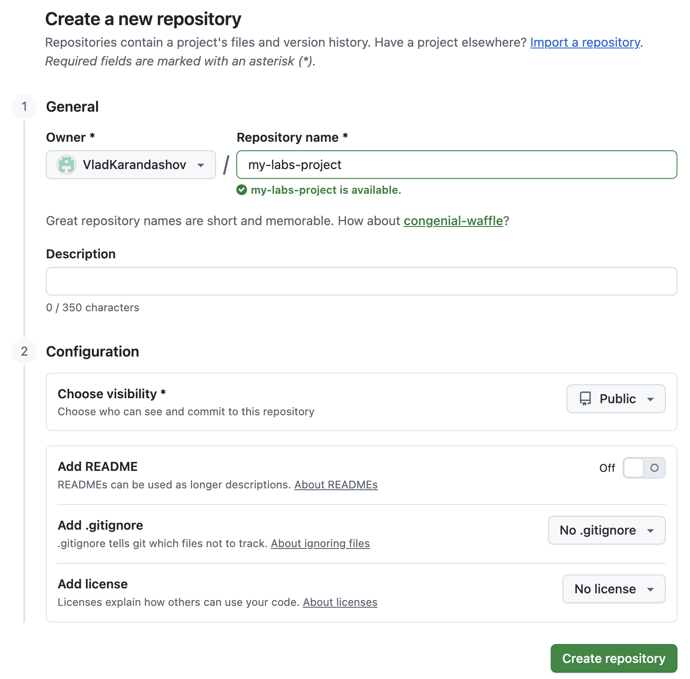
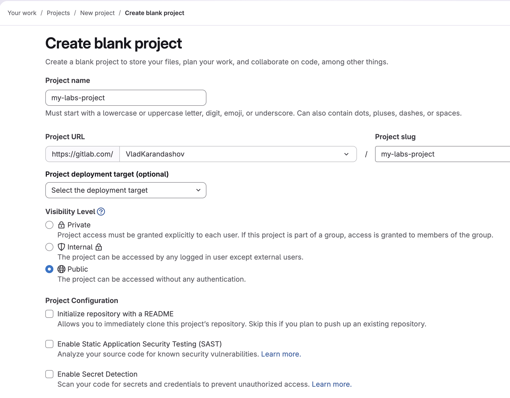

Скопируйте ssh-clone ссылку вашего репозитория. 

Нужно привязать ваш локальный репозиторий к удаленному. Для любителей терминала:
```shell
git remote add origin git@gitlab.com:VladKarandashov/my-labs-project.git
```
Для поклонников ide:
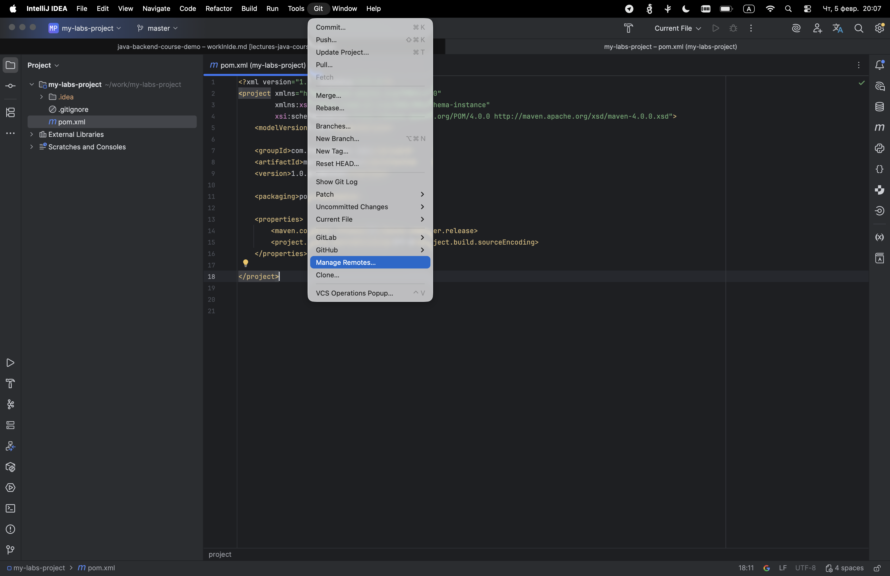
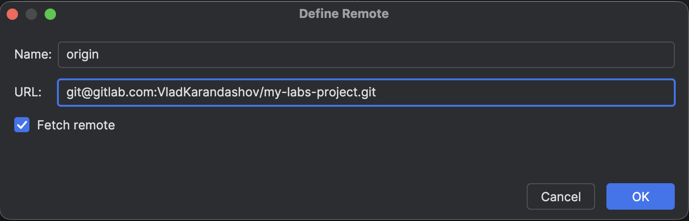

И теперь наконец можем сделать push:
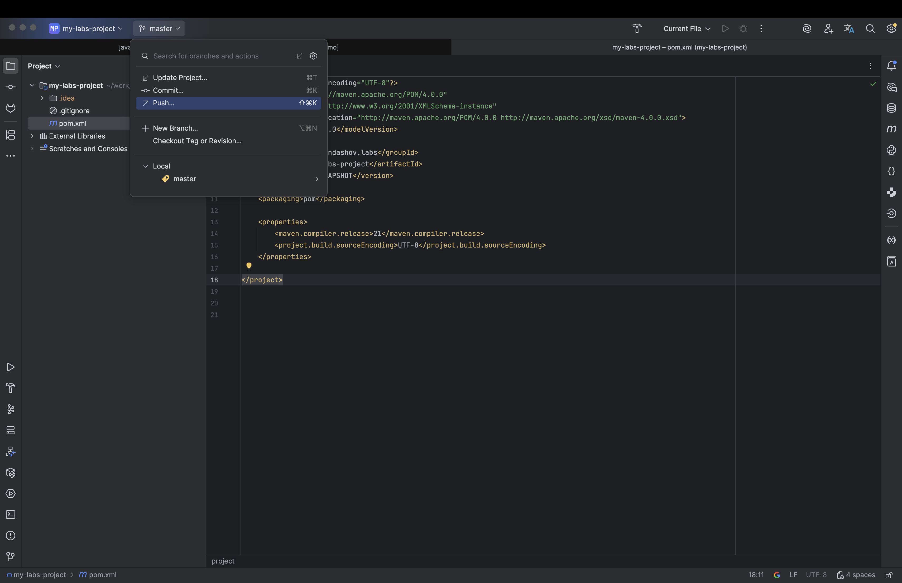
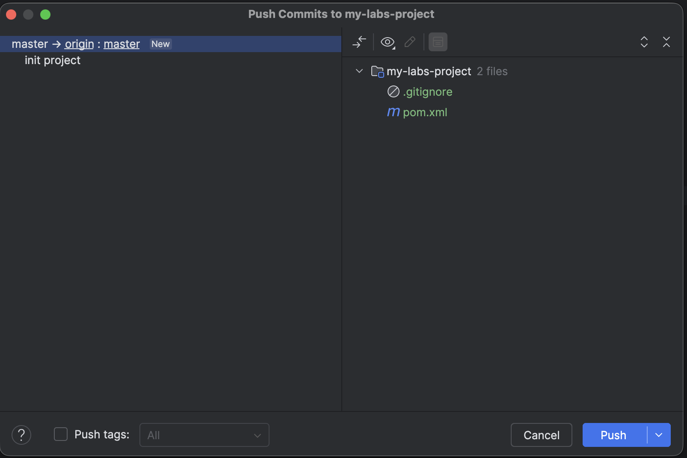
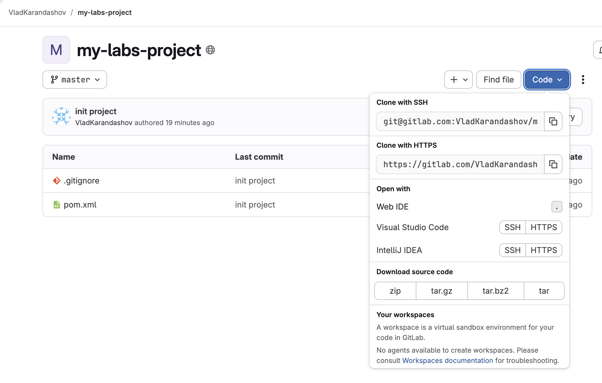

Вы замечательны! Выходим на финишную прямую.

## Разработка

Пришло время создать первый модуль нашего многомодульного проекта.
Нажмем правой кнопкой на корневую директорию и выберем создать новый модуль.

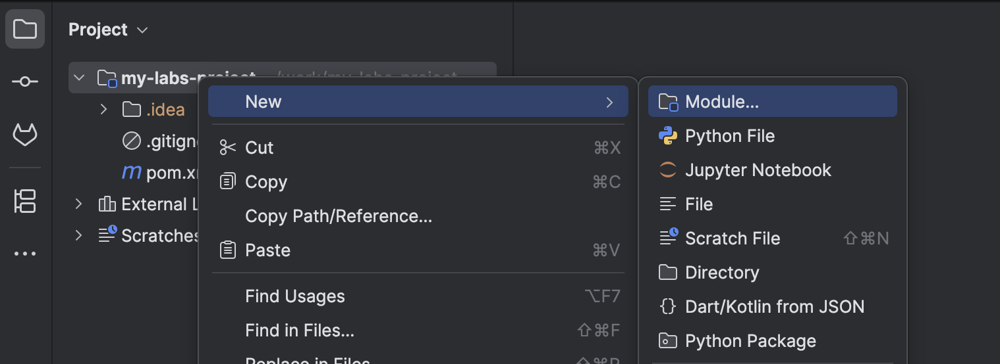

Большинство полей уже будут предзаполнены. Потому что основные вещи наследуются из корневого pom. 
Нужно только проконтролировать Name модуля.

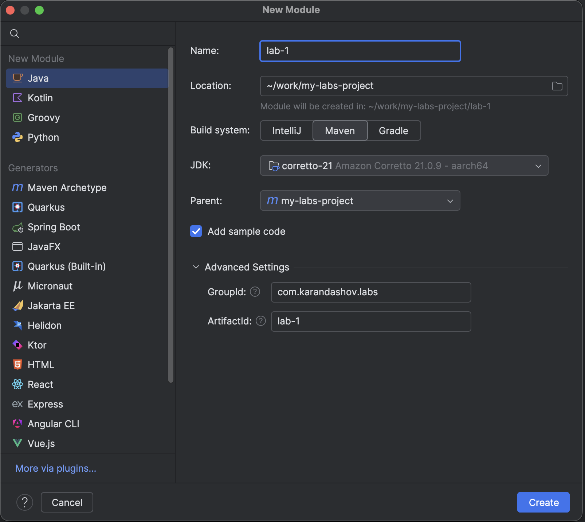

В твоем корневом pom.xml должен автоматически появиться новый блок:
```xml
<modules>
    <module>lab-1</module>
</modules>
```

Приведи свой новый pom.xml твоего нового модуля в божеское состояние (обрати внимание на параметр mainClass ниже, это важно):
```xml
<?xml version="1.0" encoding="UTF-8"?>
<project xmlns="http://maven.apache.org/POM/4.0.0"
         xmlns:xsi="http://www.w3.org/2001/XMLSchema-instance"
         xsi:schemaLocation="http://maven.apache.org/POM/4.0.0 http://maven.apache.org/xsd/maven-4.0.0.xsd">
    <modelVersion>4.0.0</modelVersion>
    <parent>
        <groupId>com.karandashov.labs</groupId>
        <artifactId>my-labs-project</artifactId>
        <version>1.0.0-SNAPSHOT</version>
    </parent>

    <artifactId>lab-1</artifactId>

    <dependencies>
        <!-- Подключаем JUnit для тестирования -->
        <dependency>
            <groupId>org.junit.jupiter</groupId>
            <artifactId>junit-jupiter</artifactId>
            <scope>test</scope>
        </dependency>
    </dependencies>

    <!-- Настройка сборки проекта -->
    <build>
        <plugins>
            <!-- Плагин для создания толстого JAR (fat JAR) со всеми зависимостями -->
            <plugin>
                <groupId>org.apache.maven.plugins</groupId>
                <artifactId>maven-shade-plugin</artifactId>
                <version>${maven.shade.plugin.version}</version>
                <executions>
                    <execution>
                        <phase>package</phase>
                        <goals>
                            <goal>shade</goal>
                        </goals>
                        <configuration>
                            <!-- Создаем исполняемый JAR с указанием главного класса -->
                            <transformers>
                                <transformer implementation="org.apache.maven.plugins.shade.resource.ManifestResourceTransformer">
                                    <!-- ВНИМАНИЕ!!! Тут должен быть твой пакет/Main, это просто пример!!! -->
                                    <mainClass>com.karandashov.labs.Main</mainClass>
                                </transformer>
                            </transformers>
                            <shadedArtifactAttached>true</shadedArtifactAttached>
                            <shadedClassifierName>fat</shadedClassifierName>
                        </configuration>
                    </execution>
                </executions>
            </plugin>
        </plugins>
    </build>

</project>
```

## Запуск полноценной сборки

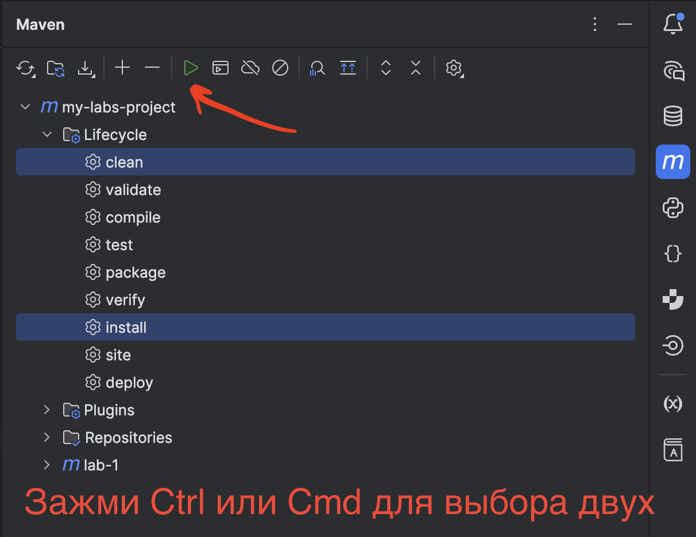

Читай [тут](errors.md) если все сломалось!

## Запуск программы

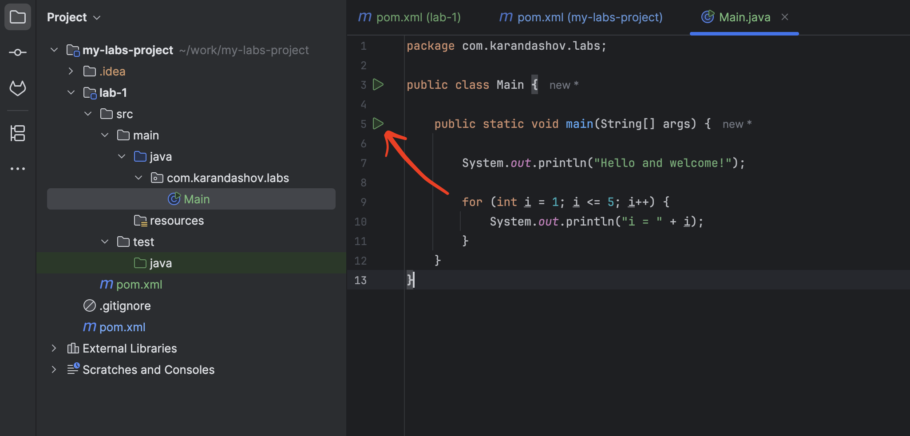

Читай [тут](errors.md) если все сломалось!

Поздравляю! Теперь ты умеешь создавать многомодульный проект и можешь приступать к реализации лабораторных!
Помогите вашим одногруппникам!