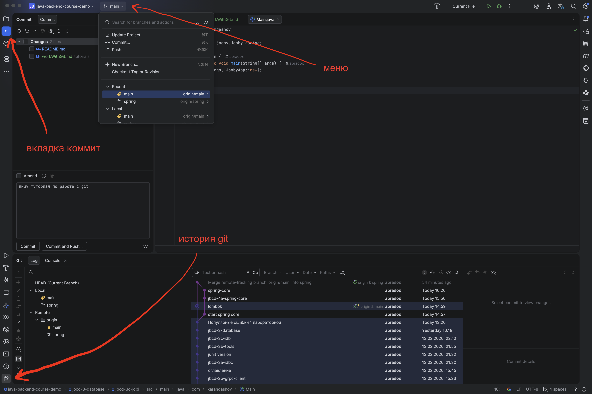

# Работа с Git в IntelliJ IDEA

## Предположения

Данный туториал предполагает, что вы уже создали git-репозиторий и оформили свой многомодульный проект (для лабораторных или для проекта). 
Если это не так, то воспользуйтесь одним из туториалов:
* [Большой гайд как начать проект для лабораторных с помощью git](startInGit.md)
* [Большой гайд как начать проект для лабораторных с помощью ide](startInIde.md)

Но видимо, вы до этого не особо работали с git, значит этот туториал для вас.

Термины, которые нужно сразу договориться понимать одинаково:
* Pull Request (GitHub) = Merge Request (GitLab) = PR — далее в тексте везде использую термин PR.
* Репозиторий — это папка проекта под управлением Git, где хранится история всех изменений.
* Коммит (commit) — это зафиксированное состояние проекта в определённый момент времени.
* Ветка (branch) — отдельная линия разработки.
* main — основная ветка проекта (иногда может называться master, но везде использую main).

## Основы работы с git

Git — это система контроля версий.
Он позволяет:
* сохранять историю изменений
* возвращаться к предыдущим версиям
* работать нескольким людям над одним проектом
* безопасно экспериментировать в отдельных ветках

Когда вы работаете с проектом, у вас есть два репозитория: локальный (local) и удаленный (origin).

Локальный репозиторий — это скрытая папка `.git` в вашем проекте, хранится у вас на компьютере.
Можно сравнить с небольшой базой данных, которая хранит историю изменений вашего проекта.
Вы редактируете файлы, делаете коммиты, переключаете ветки, экспериментируете — все изменения сначала происходят локально.

Удаленный репозиторий — это ваш репозиторий на GitHub или GitLab. Он нужен для совместной работы и хранения кода на сервере.
Вы можете загрузить изменения с локального репозитория на удаленный, чтобы другие люди могли их видеть и использовать.

Git — распределённая система.
Это значит:
* вы делаете коммит → он сохраняется локально
* пока вы не сделали push, никто его не видит

Минимальный набор операций Git:
* Commit
* * Фиксирует изменения в локальном репозитории.
* * * создаёт точку в истории
* * * позволяет откатиться
* * * делает изменения осмысленной единицей
* Push
* * Отправляет локальные коммиты в origin (GitHub/GitLab).
* Pull
* * Забирает изменения из origin к себе локально.
* Branch
* * Позволяет создавать отдельные линии разработки.

**Самое важное правило: коммитьтесь регулярно!** Это правило написано слезами от потерявшихся изменений.
ОБЯЗАТЕЛЬНО делайте коммит:
* после любого крупного изменения в коде
* **перед переключением ветки**
* **перед pull**
* перед любыми серьёзными действиями

**Откатиться можно всегда. Всегда можно попросить преподавателя помочь.** Но если не было коммита — пеняйте на себя.
Не работайте по 3 часа и 200 файлов без коммита, не переключайтесь по веткам без коммита — горько пожалеете.
Лучше иметь тонну записей в истории коммита (их потом можно схлопнуть), чем терять доработки.

## Как работать через ide

Еще раз повторю главное правило: **перед переключением ветки — всегда делайте commit**.
Если вы переключитесь с незакоммиченными изменениями:
* IDEA может не дать переключиться
* изменения могут “поехать”
* можно получить неожиданные конфликты

Закончил логический кусок работы → commit.

В IntelliJ есть несколько кнопок для работы с Git:

1) верхнее меню, где написана ваша текущая ветка
2) вкладка коммит слева сверху
3) кнопка истории гита слева внизу

Мы постараемся не использовать терминал и обойтись самыми простыми способами.

#### Как переключаться между ветками

* Сделайте commit с текущими изменениями!
* Зайдите в верхнее меню с названием ветки. 
* * Откроется окно со списком веток. Вы увидите:
* * * Local branches (локальные ветки, уже скачанные)
* * * Remote branches (origin/…, ветки в удаленном репозитории) 
* Нажмите на интересующую ветку и выберете checkout.

#### Как создать новую ветку

* Сделайте commit с текущими изменениями!
* Зайдите в верхнее меню с названием ветки.
* Нажмите New Branch и введите имя ветки.
* Idea автоматически переключит на новую ветку.

#### Как сделать Commit

* Нажмите вкладку Commit (слева вверху)
* Отметьте галочками нужные файлы
* Напишите сообщение коммита
* Нажмите Commit или Commit and Push

#### Как сделать Push

* Зайдите в верхнее меню с названием ветки.
* Нажмите кнопку Push и подтвердите во всплывшем окне.

#### Как сделать Pull

* Сделайте commit с текущими изменениями!
* Зайдите в верхнее меню с названием ветки.
* Нажмите кнопку Pull или Update Project.

#### Как создать PR

После того как вы сделали commit и push, перейдите в GitHub или GitLab:

* Вы увидите кнопку: Create Pull Request или Create Merge Request
* Создаёте PR: ваша ветка → mater/main

PR нужен для:
* проверки кода
* обсуждения
* контроля качества
* предотвращения хаоса в main

#### Запрещаем push в main

Очень рекомендуется запретить прямой push в main.

GitHub: репозиторий → Settings → Branches → add branch protection rule → укажите main

Включите:
* Require pull request before merging
* Require approvals (по желанию)

GitLab: репозиторий → Settings → Protected branches → найдите main

Поставьте галочки:
* No one для Push
* Developers + Maintainers для Merge (по ситуации)

#### Если случайно сделали commit в main

Ситуация:
* Вы забыли создать ветку
* Закоммитились в main
* Push запрещён

Это нормальная ошибка новичка. Самый простой способ исправить:
* Создайте в idea новую ветку от текущего локального main
* Сделайте Push новой ветки
* Просто удалите локальную ветку main или
* вернитесь в main и сделайте Reset main к origin/main
* * Откройте список коммитов внизу
* * Найдите origin/main
* * Правой кнопкой → Reset Current Branch to Here
* * Выберите Hard

## Trunk-based работа с ветками

Теперь переходим к самому важному для командной разработки — как правильно работать с ветками, чтобы не создавать хаос.
Мы используем самую простую и понятную модель — trunk-based development.

Trunk — это основная ветка проекта. Обычно это main или master. **Главная идея: main — это всегда стабильная версия проекта.** 
В main нельзя пушить напрямую. Изменения попадают туда только через PR.

Правила очень простые:
* main всегда рабочий.
* Каждый разработчик работает в своей ветке.
* Ветки живут недолго.
* Маленькие задачи — маленькие ветки.
* Частые PR.
* Регулярное обновление своей ветки от main.

Trunk-based делает процесс простым и предсказуемым.

### Пошаговый план работы программиста при создании фичи

#### 1) Убедиться, что main актуален

Это нужно, чтобы начинать работу от актуальной версии:
* Переключитесь на main
* Сделайте Pull
* Убедитесь, что проект компилируется

#### 2) Создать новую ветку от main

Теперь вы работаете изолированно.

#### 3) Реализовать фичу

Пишите код, регулярно делайте commit и push в свою ветку.

#### 4) Подлить себе main

За время вашей работы над фичей другие программисты могли успеть внести изменения в main, которые могут законфликтовать с вашими.
Поэтому необходимо подлить в свою ветку все обновления.

* Сделайте commit с текущими изменениями!
* Зайдите в верхнее меню с названием ветки.
* Смотрите в блок remote/origin.
* Нажмите на ветку main/master.
* Нажмите merge "origin/main" into the "current" branch.
* Решите возможные конфликты (разберём в следующем разделе).
* Еще раз соберите проект и решите возможные проблемы отдельными коммитами.
* Сделайте финальный commit и push.

#### 5) Создать PR

Уведомите других разработчиков о вашем pr.

#### 6) Ревью и merge

Получите апрувы от других участников и выполните merge. Удалите ветку фичи, чтобы не захламлять репозиторий.

### Как выглядит правильная командная работа

* Каждый создаёт ветку от main
* Каждый делает маленькую задачу
* Каждый делает PR
* После review изменения попадают в main
* Все обновляются от main
* Цикл повторяется

Это простой, понятный и масштабируемый процесс.
Если разработка задерживается — регулярно подливайте себе main (шаг 4).

## Конфликты

Конфликты — это нормальная часть командной разработки. Не нужно их бояться.
**Конфликт возникает, когда два человека изменили один и тот же участок кода по-разному.**
В этом случае Git требует вручную выбрать правильный вариант.
Старайтесь не работать одновременно над одним сервисом, но если такое все-таки случилось, то этот раздел вам поможет.

* Переключитесь на свою ветку.
* Подлейте изменения из remote/origin/main:
* * Зайдите в верхнее меню с названием ветки.
* * Смотрите в блок remote/origin.
* * Нажмите на ветку main/master.
* * Нажмите merge "origin/main" into the "current" branch.
* Появится окно конфликтов

Выбирайте по очереди каждый конфликтный файл.

IDEA откроет специальное окно сравнения. Обычно оно состоит из трёх частей:
* Левая часть — изменения из main
* Правая часть — ваши изменения
* Центральная часть — итоговый результат

Изучите изменения и нажимайте стрелочки >>> и <<< и крестик, чтобы в центре постепенно образовалась правильная версия кода.
Если вы не уверены, что выбрали правильный вариант, то нажмите кнопку "Abort merge" и попробуйте снова.
Ничего страшного, если что-то будет красное, это можно будет потом решить. Главное не потеряйте чужие изменения.

После решения конфликта
* Нажмите Apply
* Закройте окно
* IDEA покажет изменённые файлы
* Сделайте commit (это будет merge commit)
* Пересоберите проект, убедитесь, что всё работает
* Сделайте Push

Что нельзя делать при конфликте
* ❌ Паниковать
* ❌ Удалять файлы
* ❌ Копировать “что попало”
* ❌ Переключаться в другую ветку
* ❌ Делать force push

Позовите другого разработчика или преподавателя, если что-то не получается.