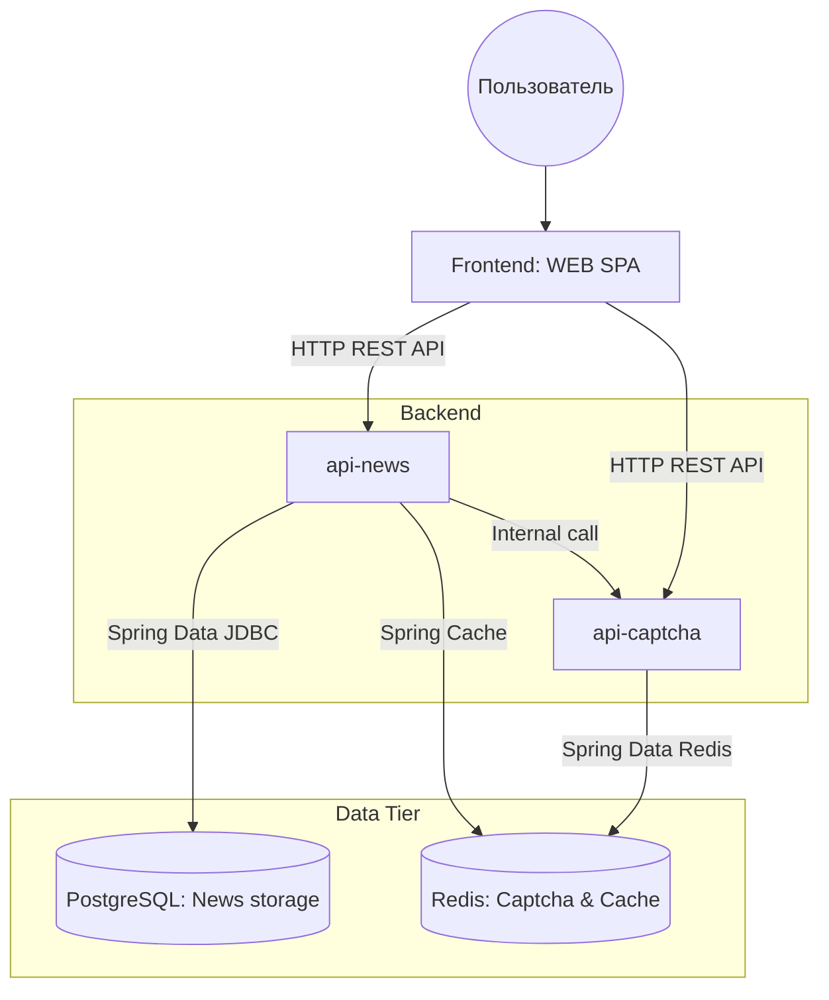
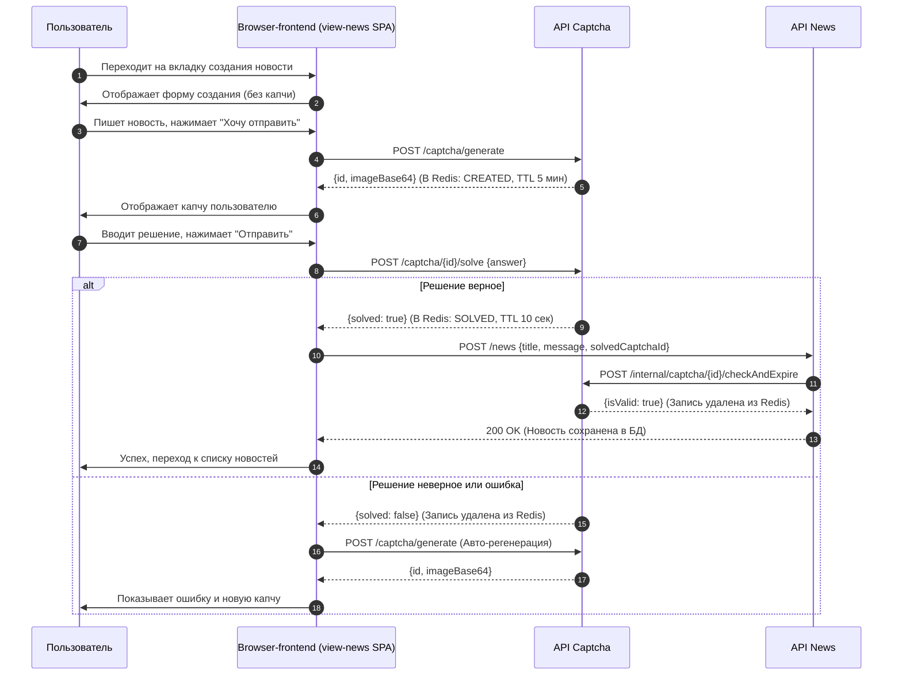

# jbcd-mini-project

### Архитектура проекта

### API

Проект состоит из нескольких микросервисов, каждый из которых предоставляет свой REST API.

| Сервис                                               | Описание                                         |
|------------------------------------------------------|--------------------------------------------------|
| [api-news](./api-news/README.md)                     | Управление новостями                             |
| [api-captcha](./api-captcha/README.md)               | Генерация и проверка капчи                       |
| [lib-client-captcha](./lib-client-captcha/README.md) | Клиент api-captcha для вызова из других сервисов |
| [lib-utils-web](./lib-utils-web/README.md)           | Общие утилиты/стандарты обработки ошибок         |
| [view-news](./view-news/README.md)                   | Frontend приложение                              |

### Процесс создания новости

### Деплой

Для локальной разработки необходимо пользоваться [local-dev](server/local-dev/docker-compose.yml).
Роль gateway выполняет простой nginx-reverse-proxy. Openobserve торчит портом 5080 наружу.

Для развертывания на сервере необходимо пользоваться [vps](server/vps) конфигурацией
и [вот этим туториалом](server/README.md).